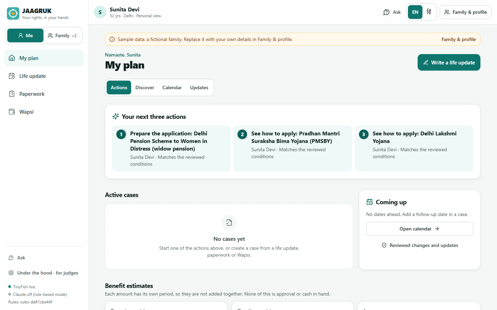
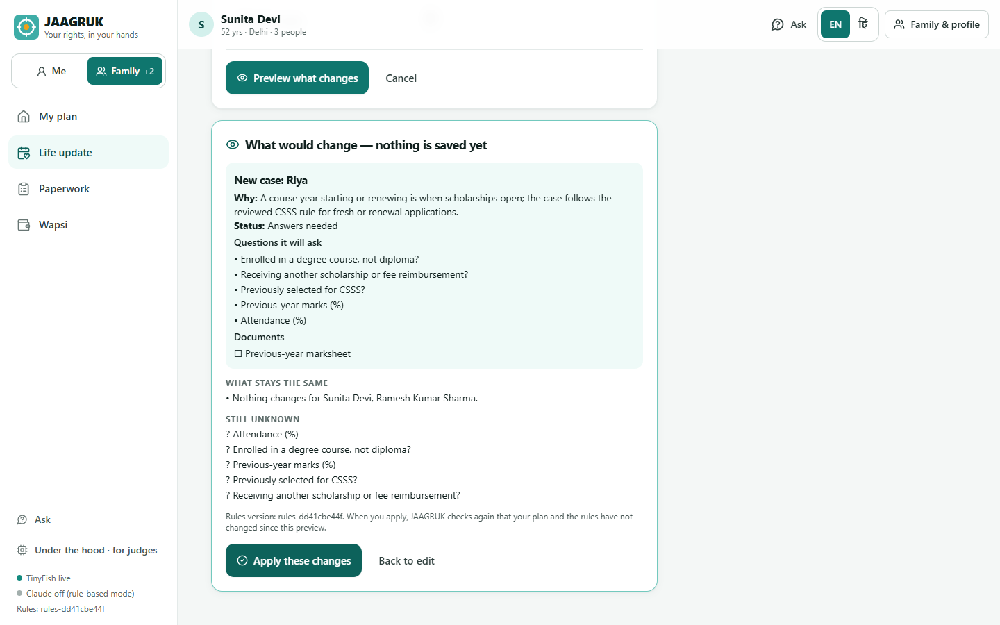
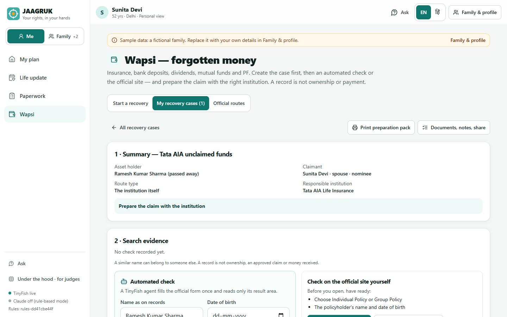
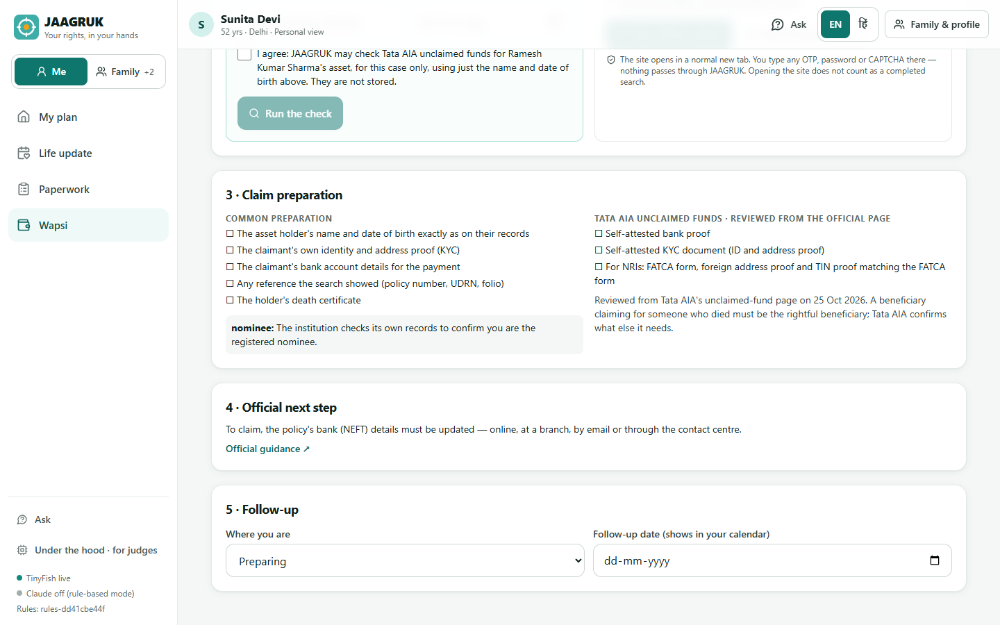
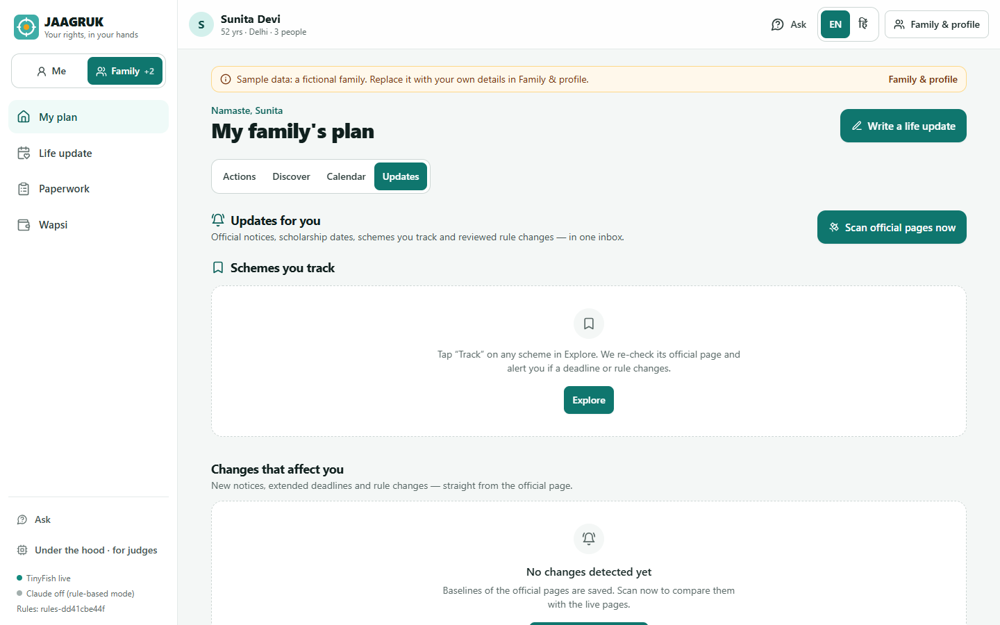

# JAAGRUK (जागरूक) — every rupee your family is owed: found, proven, claimed

**Janta's AI Agent for Government Rights, Updates & Knowledge.** A Hindi/English web app (installable PWA) that tells an
Indian family what it is entitled to — schemes, scholarships, exams, insurance and its own **unclaimed money** — checks
each answer against reviewed rules with a solver, turns life changes into ready-to-act cases, watches official pages
for changes, and prepares claims with the right institution. The citizen approves every step. It works on the **live
government web through [TinyFish](https://tinyfish.ai)**.

> **Team:** Ayush · Saif · Sagar



---

## ⚡ Run it in 3 minutes

```bash
python -m venv .venv
# Windows:        .venv\Scripts\activate
# macOS / Linux:  source .venv/bin/activate
pip install -r requirements.txt
python run.py            # live TinyFish if TINYFISH_API_KEY is set, otherwise recorded real runs
python run.py --replay   # force recorded real TinyFish runs (no key or internet needed)
```

Open **http://localhost:8000** and pick the **Sunita** sample family (or build your own profile). The frontend is
pre-built in `frontend/dist`, so Node is only needed to change it. The server listens on this computer only; use
`--host 0.0.0.0` deliberately if other devices should reach it (they could then use your TinyFish key).

Before relying on the automated Wapsi checks, re-run their live qualification (≈ $0.10, fictional test identity):

```bash
python backend/scripts/qualify_adapters.py
```

---

## 1. The problem

* **≈ ₹1.04 lakh crore of citizens' money sits unclaimed** — bank deposits, insurance, dividends, mutual funds (PIB,
  Dec 2025). When people were *helped*, ₹5,777 cr went back to 22.95 lakh claimants in three months (PIB, Mar 2026).
* Scheme rules are spread across hundreds of portals and PDFs, in legal English, and they **change without notice**.
* Each unclaimed-money portal covers one asset type and needs its own form, login, OTP or CAPTCHA — and the portal that
  *finds* money (UDGAM, MITRA, IEPF) is often not the institution that *pays* it.

Portals *list* information; nobody *watches, matches, verifies and acts* for the individual family. JAAGRUK does.

## 2. What JAAGRUK does

Four destinations: **My plan · Life update · Paperwork · Wapsi**. *Ask* and *Under the hood* are secondary.

| Feature | What the citizen sees | How it works |
|---|---|---|
| **My plan** | Next three actions (person, reason, date) → active cases → coming dates → benefit estimates by type → schemes | Actions come from cases *and* from schemes that match; "Prepare this application" opens the right case |
| **Benefit estimates** | Recurring assistance, academic-year awards, one-time help, insurance cover, credit and possible recovery — each with its period and status, never one combined total | Mutually exclusive schemes counted once |
| **Reasons, not guesses** | "Why?" on every scheme: each clause, the family's value, the official source, what is still unknown | **Z3** — matches / does not match / one answer missing |
| **Re-check live** | Which fields of the rule were compared with today's official page | **TinyFish Fetch** + Z3 equivalence proof |
| **Discover (1,135 schemes)** | Search in your own words, filters, Track; live discovery | myScheme pages read with **TinyFish Browser**; live **Search → Fetch → Browser** |
| **Life update → Preview what changes** | Write or say what happened; see who and which facts change, which cases, questions, documents and dates — and what stays the same — before applying | Local EN/HI/Hinglish reader; apply is refused if the plan or rules changed after the preview |
| **Paperwork** | The minimum checklist for this person, service and state | Reviewed routes + **TinyFish Search** for official guidance elsewhere |
| **Wapsi** | Start a recovery (holder, claimant, relationship, claim capacity, asset, route) → case → automated check or official site → evidence → claim preparation → official next step → follow-up | **TinyFish Browser playbook** (LIC) and **Agent** (Tata AIA), each live-qualified; strict outcomes |
| **Updates** | Notices that affect you, scholarship deadlines, tracked schemes and reviewed rule changes in one inbox | **TinyFish Fetch** (all boards in one call), diff, classifier; optional **Monitors** |
| **Ask** | Cited answers; live research | Retrieval over the reviewed rules + **TinyFish Research** |
| **Helper link** | Share one case for 24 h; readable summary; field-by-field conflict view | Hashed capability token in the URL fragment; helpers cannot change search evidence |
| **Under the hood** | Every TinyFish call (live/replay, latency), adapter qualification, rules version, model metrics | SQLite call log, redacted |

| Life update → Preview what changes | Wapsi recovery case |
|---|---|
|  |  |
| **Claim preparation** | **Updates inbox** |
|  |  |

**Personal and Family mode.** JAAGRUK starts in Personal mode. Family mode keeps each person's facts, documents and
cases separate — a parent's bank account or certificate is never assumed for a child.

## 3. Wapsi, done honestly

* The **recovery case is created first**; every lookup is bound to that case, holder and route. Changing the holder,
  name, date of birth or route clears consent, and a result can never be attached to a person selected later.
* Outcomes are explicit: **Possible record · No match for these submitted details · Citizen step required · Missing
  input · Unavailable · Failed · Uncertain · Cancelled**. "No match" requires the portal's own no-record message in its
  result area; CAPTCHA, outages and timeouts never become "no match".
* A record is never ownership, an approved claim or money received. Amounts stay attached to each record; nothing is
  summed. Name differences are explained in plain words; a similarity score never verifies ownership.
* Portals that need the citizen's OTP, login or CAPTCHA open on the **official website in a normal tab**. Nothing typed
  there passes through JAAGRUK; the citizen records what happened back in the case.
* Discovery services (UDGAM, MITRA, IEPF) are separated from the institution that pays (the bank, AMC/registrar,
  company). Claim requirements are shown only where they were reviewed from official pages; the rest is labelled.

| Route | JAAGRUK |
|---|---|
| LIC | Automated: playbook on a TinyFish Browser (agent only if the script breaks *before* submitting) |
| Tata AIA | Automated: TinyFish Agent (playbook only if the agent fails *before* submitting) |
| SBI Life | Official site — the citizen completes its CAPTCHA |
| RBI UDGAM | Official site → record the bank and UDRN → claim with the bank |
| MITRA (MF Central) | Official site → record the AMC/registrar → claim or transmission there |
| IEPF | Official route; company nodal officer verifies; conditional transmission for heirs |
| EPFO | Official route; no name-only search |

**Live qualification, 25 Oct 2026** (fictional identity "Jaagrukdemo Testcase", 12/03/1971): LIC — playbook, 38.6 s,
official no-record message recognised; Tata AIA — agent, 5 steps, 66 s, official no-record message recognised.

## 4. How TinyFish is used

| TinyFish product | JAAGRUK feature | Code |
|---|---|---|
| **Web Agent** (`run-sse`, `output_schema`, India proxy) | Wapsi (Tata AIA), official-checker second opinion | `services/recovery_lookup.py`, `tinyfish/harness.py` |
| **Browser** (CDP + Playwright, India proxy) | LIC playbook, Discover catalogue and re-checks | `tinyfish/playbooks.py`, `services/catalog.py` |
| **Fetch** | Updates scan, Re-check live, NSP deadlines, rule-source review | `services/change_radar.py`, `services/discover.py`, `services/source_changes.py` |
| **Search** | Discover live search, paperwork guidance, new-on-official-sites | `services/catalog.py`, `services/service_paperwork.py`, `services/discover.py` |
| **Monitor** | Always-on board watching (operator-enabled) with a private webhook | `services/change_radar.py` |
| **Research** | Ask → live research | `tinyfish/client.py::research`, `ml/assistant.py` |

Every call goes through `tinyfish/client.py`, which logs it, records successful public responses and replays **only an
exact earlier request** when there is no key or network. Personal lookups are never recorded or replayed.

## 5. Settings (`.env`)

Copy `.env.example` to `.env` (never commit it). An environment variable already set in the operating system wins.

| Variable | Default | Meaning |
|---|---|---|
| `TINYFISH_API_KEY` | — | Your key from https://agent.tinyfish.ai/api-keys. Without it the app runs on recorded real runs. |
| `TINYFISH_MODE` | `auto` | `live` · `replay` · `auto` |
| `TINYFISH_PROXY_COUNTRY` | `IN` | Exit country for TinyFish browsers and agents |
| `AGENT_MAX_SECONDS` / `AGENT_MAX_STEPS` | `180` / `30` | Hard caps per agent run |
| `ANTHROPIC_API_KEY` | — | Optional: Claude writes cited answers and extracts rules. Rule-based fallbacks otherwise. |
| `PUBLIC_BASE_URL` | — | Optional public https URL so TinyFish Monitors can call the webhook |
| `JAAGRUK_REVIEW_KEY` | — | Enables rule review and monitor controls (operator only) |
| `JAAGRUK_DB` | `var/jaagruk.db` | Server database (call log, job ledger, helper links, reviewed changes) |

## 6. Tests

```bash
python -m pytest backend/tests -q      # 103 tests, offline (replay mode, throwaway database)
cd frontend
npm ci
npm test                               # calendar, workspace scope/sharing/storage, life-update consent
npm run build
```

Tests use saved or mocked evidence and fictional families. They do not establish live-portal success, beneficiary
outcomes or model generalisation. See [docs/VALIDATION.md](docs/VALIDATION.md).

## 7. Architecture & AI/ML

* **Backend:** FastAPI (Python 3.12); jobs with a SQLite ledger (idempotent starts, cancellation, account-wide and
  per-client limits, honest "uncertain" after a restart); SQLite WAL; in-memory FTS5 for Discover.
* **One reviewed rule registry** (`services/rules_registry.py`): My plan, cases, Discover, Ask and the official checker
  read the same version; public reads only create review candidates; approval publishes atomically.
* **Frontend:** React 18 + TypeScript + Vite + Tailwind PWA, Hindi/English, lazy-loaded screens, one accessible dialog
  primitive, error boundary, stale-response protection.
* **Reasoning:** Z3 three-valued eligibility with unsat cores, `z3.Optimize` unlock paths, rule-drift proofs.
* **Models:** Indic name matcher (fuzzy, phonetic, initials; F1 0.979 on *synthetic* pairs with an identity-grouped
  split); circular-statistics exam forecaster. The life-update reader is editable patterns, not a trained model.

## 8. Data, privacy and safety

* The family workspace and journal live **in this browser**; plan requests are evaluated per request and not stored.
* A helper link stores only one case for 24 hours behind a hashed token; helpers cannot rewrite search evidence.
* No identity numbers, passwords or OTPs are requested; no OTP or password ever passes through JAAGRUK.
* Private responses are `no-store`; questions never travel in URLs; monitor and reviewer controls need the operator key;
  webhooks need a private token and are re-read from the registered page before any alert.

## 9. Honest limitations

* Reviewed preparation routes cover the modelled conditions (Delhi pensions, CSSS, ONORC, selected Aadhaar/PAN/licence
  and income-certificate routes). Other services get official-guidance leads, not invented checklists.
* 2 of 7 Wapsi routes are automated; 5 need the citizen on the official site by design. Detailed claim checklists are
  reviewed only for Tata AIA; others are labelled.
* Discover covers 1,135 pages read so far; most myScheme pages state no date, shown as "availability unknown".
* No real money has been found: all live tests use a fictional identity.

## 10. Repository layout

```
backend/app/        FastAPI app, routers, services (planning, paperwork, recovery, rules registry, catalog…), ML, TinyFish client
backend/app/data/   rules, recovery routes, adapter qualification, personas, catalogue (myScheme + NSP), recordings
backend/scripts/    qualify_adapters.py, crawl_myscheme.py, save_capture.py
backend/tests/      103 offline tests
frontend/src/       React app: pages/, workspace/ (cases, life updates, sharing), components/
docs/               JUDGE_BUILD_CHANGES.md, VALIDATION.md, EXPLORE.md, TINYFISH_EVIDENCE.md, REVENUE_MODEL.md, FAQ.md
```

MIT licensed. Team: Ayush, Saif and Sagar.
