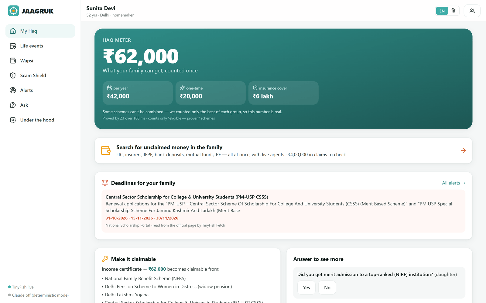
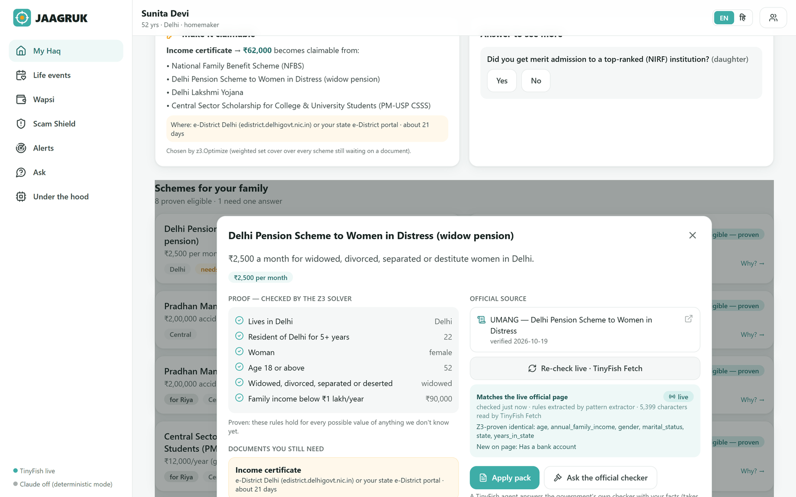
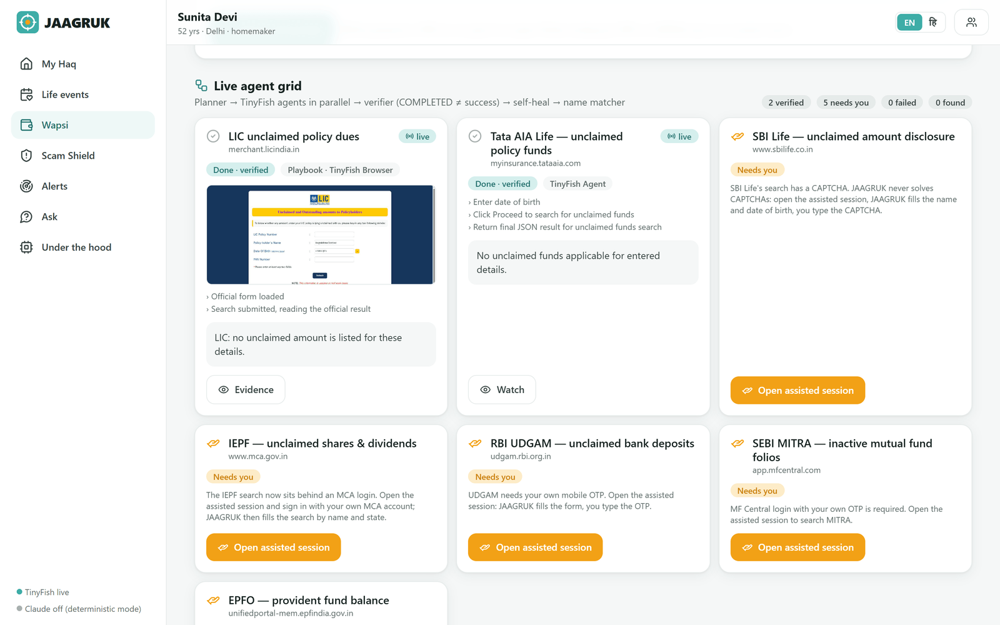
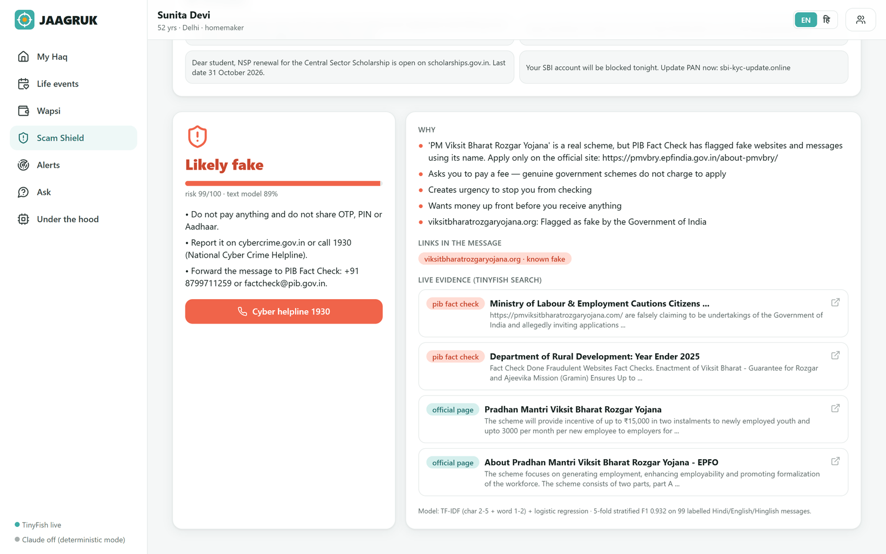
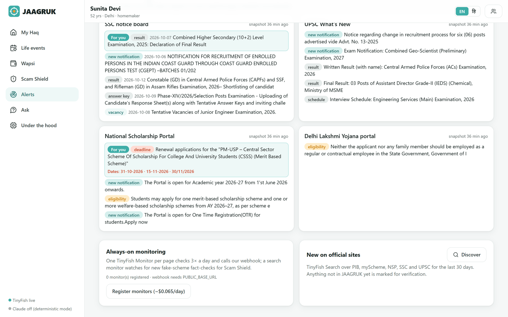
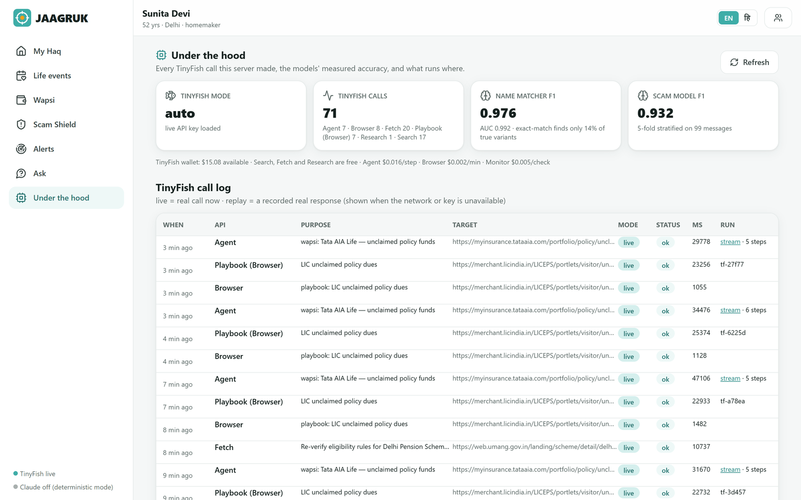

# JAAGRUK (जागरूक) — every rupee your family is owed: found, proven, claimed

**Janta's AI Agent for Government Rights, Updates & Knowledge.** A Hindi/English web app (installable PWA) that tells an
Indian family what it is entitled to — schemes, scholarships, exams, insurance and its own **unclaimed money** — *proves*
each answer, watches official notice boards for changes, catches scam "yojanas", and helps the family claim, with the
citizen approving every step. It works on the **live government web through [TinyFish](https://tinyfish.ai)**.

> **Team:** Ayush · Saif · Sagar



---

## ⚡ Evaluate in 3 minutes (no API key needed)

```bash
git clone https://github.com/sagar25446-prog/HackIIITD.git
cd HackIIITD
python -m venv .venv
# Windows:            .venv\Scripts\activate
# macOS / Linux:      source .venv/bin/activate
pip install -r requirements.txt
python run.py --replay
```

Open **http://localhost:8000**, click the **Sunita** demo family, and follow the [walkthrough](#-evaluation-walkthrough).

`--replay` serves **recorded real TinyFish responses** (captured from the live government portals on 19 Oct 2026), so
every screen works without a key or internet; the UI labels them "replay". To see TinyFish calls happen live, add a key
([below](#run-with-live-tinyfish)). The frontend is pre-built in `frontend/dist`, so **Node is not needed** to run it.

---

## Contents
1. [The problem](#1-the-problem) · 2. [What JAAGRUK does](#2-what-jaagruk-does) · 3. [How TinyFish is used](#3-how-tinyfish-is-used)
4. [Run it](#4-run-it) · 5. [Evaluation walkthrough](#-evaluation-walkthrough) · 6. [Tests](#6-tests)
7. [Architecture & AI/ML](#7-architecture--aiml) · 8. [Revenue model](#8-revenue-model) · 9. [Safety & privacy](#9-safety--privacy)
10. [Limitations](#10-honest-limitations) · 11. [Repository layout](#11-repository-layout) · 12. [Team](#12-team)

---

## 1. The problem

* **≈ ₹1.04 lakh crore of citizens' money sits unclaimed** — bank deposits ₹78k cr, insurance ₹14k cr, dividends ₹9k cr,
  mutual funds ₹3k cr (PIB, Dec 2025). When people were *helped*, ₹5,777 cr went back to 22.95 lakh claimants in three
  months (PIB, Mar 2026) — the money is claimable; people just can't find it.
* Scheme rules are spread across hundreds of portals and PDFs, in legal English, and they **change without notice**.
* Each unclaimed-money portal covers one asset type, needs its own form, login, OTP or CAPTCHA.
* Scammers fill the gap: fake "yojana" sites charge "registration fees" (PIB Fact Check flags them regularly).

**Our problem statement:** millions of eligible Indians miss benefits, deadlines and even their own money because the
information is fragmented, unstructured, changing and rarely in their language. Portals *list* information; nobody
*watches, matches, verifies and acts* for the individual family.

## 2. What JAAGRUK does

| Feature | What the citizen sees | How it works |
|---|---|---|
| **Profile in 90 s** | 10 voice-friendly questions in Hindi or English | Web Speech API (hi-IN/en-IN), multi-label persona (`services/persona.py`) |
| **Haq Meter** | One ₹ number for the whole family: yearly, one-time, insurance cover, credit | Only **proven-eligible** schemes counted; mutually exclusive schemes counted once |
| **Proof, not guesses** | "Why?" shows every rule clause, the family's value and the official source | **Z3 SMT solver**: eligible / not eligible / needs one answer, with the failing clause (unsat core) |
| **Re-check live** | "Matches the live official page — Z3-proven identical" | **TinyFish Fetch** re-reads the official page → rule extractor → Z3 proves equivalence or shows a counter-example |
| **Make it claimable** | "Income certificate → ₹62,000 becomes claimable" | `z3.Optimize` weighted set cover over missing documents |
| **Life-event mode** | Death in family, baby born, Class 12, job loss, turning 60, new business → checklist | Curated claims + schemes per event |
| **Wapsi (unclaimed money)** | 7 official portals searched in parallel, live agent grid, claim kit | **TinyFish Agent + Browser**, verifier, self-heal, Indic name matcher |
| **Scam Shield** | Paste a message → "Likely fake", reasons, PIB Fact Check links, 1930 helpline | ML text model + fraud rules + look-alike domains + **TinyFish Search** evidence |
| **Change Radar** | "Your daughter's CSSS renewal closes 31-10-2026" | **TinyFish Fetch** of official notice boards → diff → classifier → personalised alerts; **TinyFish Monitors** for always-on watching |
| **Ask JAAGRUK** | Cited answers; "Read official sites live" | Retrieval over the verified rules + **TinyFish Research** |
| **Acts for you** | Application packs, CPGRAMS grievance drafts, assisted sessions | Never submits anything itself; the citizen approves and types OTPs |
| **Under the hood** | Every TinyFish call, live vs replay, latency, run IDs; model metrics | SQLite call log |

| Proof + live re-check | Wapsi live agent grid |
|---|---|
|  |  |
| **Scam Shield** | **Change Radar** |
|  |  |

## 3. How TinyFish is used

TinyFish is the core of JAAGRUK, not a decoration: without it the app cannot read official pages, search for evidence,
or act on portals. **All six TinyFish products** are used, each for what it is best at.

| TinyFish product | JAAGRUK feature | Code | What happens |
|---|---|---|---|
| **Web Agent** — `run-sse`, `output_schema`, India proxy | Wapsi (Tata AIA), official-checker second opinion, self-heal fallback for broken playbooks | `backend/app/tinyfish/client.py::agent_stream`, `tinyfish/harness.py` | Natural-language goal with a strict JSON schema; `STREAMING_URL` and `PROGRESS` events stream into the live agent grid ("Watch" button) |
| **Browser Infrastructure** — CDP + Playwright, India proxy | Wapsi playbooks (LIC), **assisted sessions** (SBI Life, IEPF, UDGAM, MF Central, EPFO, CPGRAMS) | `tinyfish/playbooks.py`, `services/assisted.py` | Deterministic scripts on a TinyFish cloud browser (LIC answers in ~25 s); for OTP/CAPTCHA portals the citizen clicks/types on a streamed remote browser — the OTP goes straight to the site |
| **Fetch** — up to 10 URLs per call, `ttl=0` | Change Radar, Re-check live, deadline cards | `services/change_radar.py`, `services/discover.py::refresh_rule` | Reads SSC, UPSC, NSP and Delhi Lakshmi Yojana boards in **one call**; re-reads each scheme's official page for the Z3 drift proof |
| **Search** — `include_domains`, recency | Scam Shield evidence, "New on official sites" | `services/scam_shield.py`, `services/discover.py::discover` | PIB Fact Check + official-site existence + fraud reports for unknown domains |
| **Monitor** — fetch & search monitors, cron, webhook | Always-on Change Radar | `change_radar.register_monitors / on_webhook` | One monitor per notice board (3×/day) + a fake-scheme topic monitor → `/api/radar/webhook` → diff → alerts (opt-in from the Alerts page; ≈ $0.07/day) |
| **Research** — `run-research` SSE | Ask → "Read official sites live" | `client.py::research`, `ml/assistant.py` | Plans sub-questions, reads sources, streams a cited report; official sources are badged |

**The harness** (`tinyfish/harness.py`) turns raw TinyFish calls into something a citizen can trust:
planner → playbook ⇄ agent in parallel → **verifier** ("COMPLETED ≠ success": catches empty results, a CAPTCHA reported
as "not found", the agent echoing the searched name, non-official links, portal errors) → **self-heal** (playbook ⇄
agent, re-planned goal, stealth retry) → **human hand-off** for CAPTCHA/OTP/login → **record & replay**.

**Tested on the real portals** — run IDs, costs and what we changed are in
[docs/TINYFISH_EVIDENCE.md](docs/TINYFISH_EVIDENCE.md). Highlights: Indian portals refused foreign IPs (fixed with
`country_code: IN`); an agent "completed" on SBI Life by hitting a CAPTCHA (now caught by the verifier and routed to the
citizen); IEPF moved behind a login (assisted session). Total spend on all live validation ≈ $0.60.



## 4. Run it

**Prerequisites:** Python **3.11 or 3.12** (developed on 3.12). Node 20+ is *only* needed if you change the frontend.

### Run offline (replay of real TinyFish runs) — recommended for a first look
```bash
pip install -r requirements.txt
python run.py --replay          # → http://localhost:8000
```

### Run with live TinyFish
1. Create a free TinyFish account and an API key at **https://agent.tinyfish.ai/api-keys**.
2. Copy the example config and paste the key:
   ```bash
   cp .env.example .env            # Windows: copy .env.example .env
   # edit .env →  TINYFISH_API_KEY=your-key
   ```
3. `python run.py` → http://localhost:8000. The sidebar shows **"TinyFish live"**; the *Under the hood* page shows each call.

`TINYFISH_MODE=auto` (default) calls TinyFish live and falls back to a recorded real response if the network fails.

### All settings (`.env`)
| Variable | Default | Meaning |
|---|---|---|
| `TINYFISH_API_KEY` | — | Your TinyFish key. Without it the app runs on recorded real runs. |
| `TINYFISH_MODE` | `auto` | `live` · `replay` · `auto` |
| `TINYFISH_PROXY_COUNTRY` | `IN` | Exit country for TinyFish browsers/agents (Indian portals often block foreign IPs) |
| `AGENT_MAX_SECONDS` / `AGENT_MAX_STEPS` | `180` / `30` | Hard caps per agent run (step cap used only where the account supports it) |
| `ANTHROPIC_API_KEY` | — | Optional: Claude writes cited answers and extracts rules (structured outputs). Deterministic fallbacks otherwise. |
| `PUBLIC_BASE_URL` | — | Optional public https URL (e.g. a tunnel) so TinyFish Monitors can push to `/api/radar/webhook` |

### Develop
```bash
python run.py --dev                     # API with auto-reload on :8000
cd frontend && npm install && npm run dev   # UI on :5173 (proxies /api)
```

## 🧪 Evaluation walkthrough

Works in `--replay` mode; steps marked **(live)** need a TinyFish key.

| # | Do | You should see |
|---|---|---|
| 1 | Open http://localhost:8000 → **Build my profile** → press 🎤 (Chrome/Edge) and speak, or type | 10 questions, read aloud, Hindi/English toggle |
| 2 | **Back** → click **Sunita, 52 — widow, Delhi** | Haq Meter **₹62,000** (₹42,000/yr + ₹20,000 one-time), ₹6 lakh cover, "counted once" note |
| 3 | Scroll: **Deadlines for your family** | CSSS scholarship renewal for her daughter, dates **31-10-2026**, read from the NSP page by TinyFish Fetch |
| 4 | **Make it claimable** card | Income certificate → ₹62,000 across 4 schemes (z3.Optimize) |
| 5 | Click **Delhi Pension Scheme to Women in Distress → Why?** → **Re-check live** | Proof lines (✓ per clause), official UMANG source, then "Matches the live official page — Z3-proven identical: age, income, gender, marital status, state, years in state" |
| 6 | **Wapsi** → name `Jaagrukdemo Testcase`, DOB `12/03/1971`, tick consent → **Search all portals** | Live agent grid: LIC (Playbook · TinyFish Browser, with the real LIC page as evidence), Tata AIA (TinyFish Agent, progress steps), five portals "Needs you" with the reason (CAPTCHA/OTP/login) |
| 7 | **(live)** On SBI Life click **Open assisted session** → **End session** | The real SBI Life page streamed from a TinyFish cloud browser; you could click and type the CAPTCHA |
| 8 | **Scam Shield** → click the first example | **Likely fake**: "PM Viksit Bharat Rozgar Yojana is a real scheme, but PIB Fact Check has flagged fake websites…", PIB links, 1930 helpline |
| 9 | **Alerts** → **Scan official pages now** | 4 official boards read in one Fetch call; items classified (deadline, result, vacancy…), "For you" highlights |
| 10 | **Ask** → tap *"Delhi widow pension: monthly amount and who is eligible"* → **Read official sites live** | Cited answer from the rule base, then a TinyFish Research report with official sources badged |
| 11 | **Under the hood** | Every TinyFish call (Search/Fetch/Agent/Browser/Playbook/Research), live vs replay, latency, run IDs; name-matcher F1 0.976, scam-model F1 0.932 |
| 12 | Switch to **हि** (top right); open on a phone-width window | Hindi UI; responsive layout with bottom navigation |

The other demo families: **Riya** (SC student — scholarships, SSC eligibility with age relaxation) and **Ramesh**
(tailor — PM Vishwakarma, Mudra credit).

## 6. Tests

```bash
cd backend
python -m pytest -q        # 21 tests, fully offline (TinyFish in replay mode)
```

Covered: Z3 three-valued proofs and unsat cores, the Sunita Haq Meter story, family-member evaluation, exam age
relaxation, rule extraction + Z3 drift proofs, contradiction rejection, Indic name matching, the scam model, Change Radar
diffs, the verifier (CAPTCHA-as-success, echoed names, non-official links, portal errors), planner routing, API end-to-end,
**72 parallel requests** (Z3 thread safety), and the Research stream always ending. CI runs the tests and the frontend
build on every push (`.github/workflows/ci.yml`).

## 7. Architecture & AI/ML

```
React + TypeScript + Tailwind PWA (Hindi/English, Web Speech voice)
        │  REST + Server-Sent Events (live agent grid, research stream)
FastAPI (backend/app/main.py) — also serves the built PWA
  ├─ tinyfish/client.py     Search · Fetch · Agent run-sse · Browser · Monitor · Research · record/replay
  ├─ tinyfish/harness.py    planner → executor → verifier → self-heal → human hand-off
  ├─ tinyfish/playbooks.py  deterministic portal scripts on TinyFish Browser (LIC, Tata AIA)
  ├─ ml/eligibility.py      Z3 proofs, unsat cores, unlock path (z3.Optimize), exam age relaxation
  ├─ ml/extract.py          notice text → rule conditions (Claude structured output or patterns) → Z3 drift proof
  ├─ ml/name_match.py       Devanagari→Latin + Indic phonetic key + fuzzy/initials features → logistic model
  ├─ ml/scam.py             TF-IDF (char 2-5 + word 1-2) logistic model + fraud rules + look-alike domains
  ├─ ml/change.py           notice-board diff + change classifier
  ├─ ml/assistant.py        retrieval over verified rules, cited answers, support check, Research stream
  ├─ ml/forecaster.py       next exam-notice window (circular statistics over past notice months)
  └─ services/*             entitlements (Haq Meter), wapsi, scam_shield, change_radar, assisted, claims, discover
SQLite: TinyFish call log, notice snapshots, alerts, cache
```

| Model | Result |
|---|---|
| Name matcher (Wapsi) | F1 **0.976**, AUC 0.992 on held-out pairs; exact matching finds only **14 %** of true variants ("R. K. Sarma", "रमेश कुमार शर्मा") |
| Scam classifier | F1 **0.932**, 5-fold stratified CV on 99 labelled Hindi/English/Hinglish messages |
| Eligibility | Z3 proofs over 29 scheme rules + 3 exams; rule drift proven against live official pages |

## 8. Revenue model

**Citizens never pay** (genuine schemes never charge, and JAAGRUK says so on every screen). Revenue comes from those who
already pay or earn to reach these citizens:

| Who pays | What | Price | Justification |
|---|---|---|---|
| CSC operators, NGOs, college scholarship cells | Multi-family console, pre-filled packs, alerts, Wapsi runs | **₹199 / centre / month** | A CSC already earns **₹30 per scholarship application** (NSP) — 7 extra applications a month pay for it; 5.16 lakh CSCs exist |
| Banks, insurers, AMCs | Consented, name-matched, document-ready claimants for their unclaimed accounts | **1 % of settled amount, max ₹500/claim** | RBI pays banks **5–7.5 %** of each settled unclaimed deposit; average campaign claim ≈ ₹25,000 → ≈ ₹250 fee |
| District / state departments | Entitlement-gap dashboards (aggregated, privacy-preserving) | **₹2 lakh / district / year** after a free pilot | Funded from scheme awareness budgets; price to be validated in pilots |

Year-2 projection ≈ **₹2.9 crore** (1 % of CSCs, 50,000 settled claims, 20 districts) against a measured marginal cost of
≈ ₹8.5 per Wapsi search. Full market research, sources and unit economics: **[docs/REVENUE_MODEL.md](docs/REVENUE_MODEL.md)**.

## 9. Safety & privacy

* **Never solves CAPTCHAs.** Portals with a CAPTCHA, OTP or login open as an assisted session where the citizen types it.
* **No passwords, tokens or OTPs in any agent goal.** Assisted-session keystrokes go straight to the website — never
  logged, stored or shown to an AI.
* **Consent before every portal search; nothing is submitted on the citizen's behalf.**
* **No Aadhaar collected.** The profile lives in the browser (localStorage); the server keeps only the TinyFish call log
  and notice snapshots.
* Every eligibility result, alert and answer links to its **official source**. Development tests used only the fictional
  name "Jaagrukdemo Testcase".

## 10. Honest limitations

* Coverage today: Central + Delhi (29 schemes, 3 exams), 7 unclaimed-money portals, 4 notice boards.
* Of the 7 Wapsi portals, LIC and Tata AIA are automated end to end; the other five require the citizen's CAPTCHA/OTP/login
  by design.
* TinyFish Research is limited to 5 runs/day per account; JAAGRUK reuses research per question and falls back to the
  closest earlier real run.
* Without an Anthropic key, Ask answers quote the verified rule text rather than writing prose.
* Assisted sessions and live agent runs need a TinyFish key (replay mode shows recorded real runs).
* Some secondary screens are still English in Hindi mode. Voice uses the browser's Web Speech API (Chrome/Edge).

More in [docs/ENGINEERING_NOTES.md](docs/ENGINEERING_NOTES.md) (14 problems found by live testing and how each was fixed)
and [docs/FAQ.md](docs/FAQ.md).

## 11. Repository layout

```
run.py                     one-command launcher (builds the PWA if needed, serves on :8000)
requirements.txt           Python dependencies (pinned)
.env.example               configuration template (copy to .env)
backend/app/               FastAPI app, TinyFish client + harness, ML, services
backend/app/data/          scheme rules (official sources), exams, life events, documents, portals, personas, scam dataset
backend/app/data/captures/ real TinyFish responses captured during live testing (provenance for replay)
backend/app/data/recordings/ replayable recordings (generated from captures + live runs)
backend/tests/             21 offline tests
backend/scripts/           tooling to save new TinyFish captures
frontend/                  React PWA source; frontend/dist is the pre-built app
docs/                      pitch deck, revenue model, TinyFish evidence, engineering notes, FAQ, demo-video script, screenshots
ROADMAP.md                 what's built and what's next
```

## 12. Team

Ayush · Saif · Sagar

Licensed under the MIT License.
